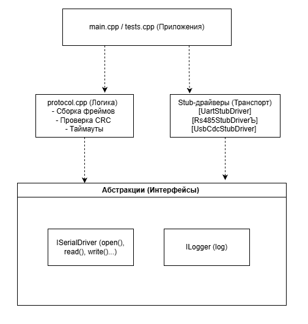
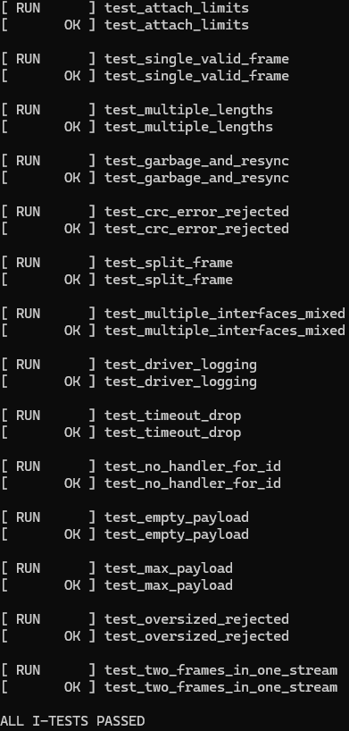
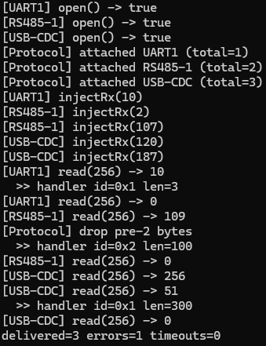

# StubDriversProject


## Реализация

1. Реализованы классы `UartStubDriver`, `Rs485StubDriver`, `UsbCdcStubDriver`, наследующие общий интерфейс `ISerialDriver`.
2. Все вызовы методов драйверов (`open`, `close`, `read`, `write`) логируются через интерфейс `ILogger`. Также есть реализация `ConsoleLogger` и `CollectLogger` для тестов.
3. Класс `Protocol` позволяет прикрепить (`attach`) от 1 до 5 драйверов, лишние игнорируются с предупреждением в логе.
4. Реализована ресинхронизация по SOF (Start Of Frame) при появлении мусора в потоке, проверка CRC16 и защита от «зависших» фреймов с помощью таймаута (`chrono`).
5. Протокол поддерживает payload от 0 до 1024 байт.
6. Проект собирается через CMake (C++14). Исполняемый файл `app` демонстрирует работу, `integration_test` запускает тесты.
7. Написано 14 интеграционных тестов на абстрактных данных (без сторонних фреймворков) с проверкой всех граничных случаев.

## Архитектура
Проект разделен на слои: приложений, абстракции (интерфейсы), транспорт (драйверы) и логика (протокол).

  

Протокол использует фрейминг с жесткой структурой и контролем целостности:
```text
| SOF1 (0xAA) | SOF2 (0x55) | ID (1B) | LEN (2B) | PAYLOAD (0..1024B) | CRC16 (2B) |
```
SOF1 / SOF2 — маркеры начала фрейма для ресинхронизации.
ID — идентификатор сообщения.
LEN — длина payload.
CRC16 — контрольная сумма от полей ID, LEN и PAYLOAD.

# Настройка проекта
```text
cmake -S . -B build
```
# Сборка
```text
cmake --build build
```
# Запуск демонстрации
```text
./build/app
# (Windows: .\build\Debug\app.exe)
```
# Запуск тестов
```text
./build/integration_test
# (Windows: .\build\Debug\integration_test.exe)
```
# Интеграционные тесты
Реализовано 14 тестов, покрывающих ключевые сценарии работы:
1. test_attach_limits — проверяет, что протокол принимает от 1 до 5 интерфейсов.
2. test_single_valid_frame — доставка одного корректного сообщения.
3. test_multiple_lengths — отправка сообщений разной длины подряд.
4. test_garbage_and_resync — проверка, что мусор в потоке не ломает прием валидного фрейма.
5. test_crc_error_rejected — фрейм с поврежденной CRC16 должен быть отвергнут.
6. test_split_frame — сборка фрейма, который приходит раздробленным на куски.
7. test_multiple_interfaces_mixed — одновременная работа UART, RS485 и USB CDC без смешивания данных.
8. test_driver_logging — проверка, написания логов вызовов.
9. test_timeout_drop — если фрейм пришел не полностью, по таймауту буфер должен сброситься.
10. test_no_handler_for_id — если для сообщения нет обработчика, оно не считается доставленным, но и не вызывает ошибку парсинга.
11. test_empty_payload — корректная обработка сообщения с пустым payload (LEN=0).
12. test_max_payload — корректная обработка сообщения с максимальным payload (1024 байта).
13. test_oversized_rejected — фрейм с LEN > 1024 отвергается, протокол продолжает работу.
14. test_two_frames_in_one_stream — два фрейма, пришедшие слитно в одном буфере, обрабатываются оба.

Ожидаемый вывод при успешной отработке тестов:  

 

# Демонстрация
В main.cpp реализована имитация работы приложения с тремя интерфейсами (UART, RS485, USB CDC). Демонстрация наглядно показывает, как протокол собирает длинные сообщения из фрагментов и успешно обрабатывает несколько фреймов подряд с разными ID и длинами.  
Почему в итоге выводится errors=1?  
Это заложенный намеренно в демонстрацию сценарий. В поток RS485 перед валидным фреймом подмешиваются два мусорных байта (0xDE, 0xAD). Протокол успешно распознаёт их как мусор, отбрасывает.

Ожидаемый вывод при успешной отработке:




